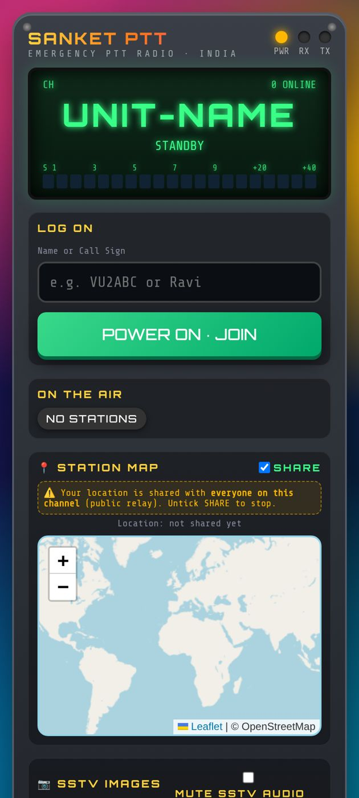
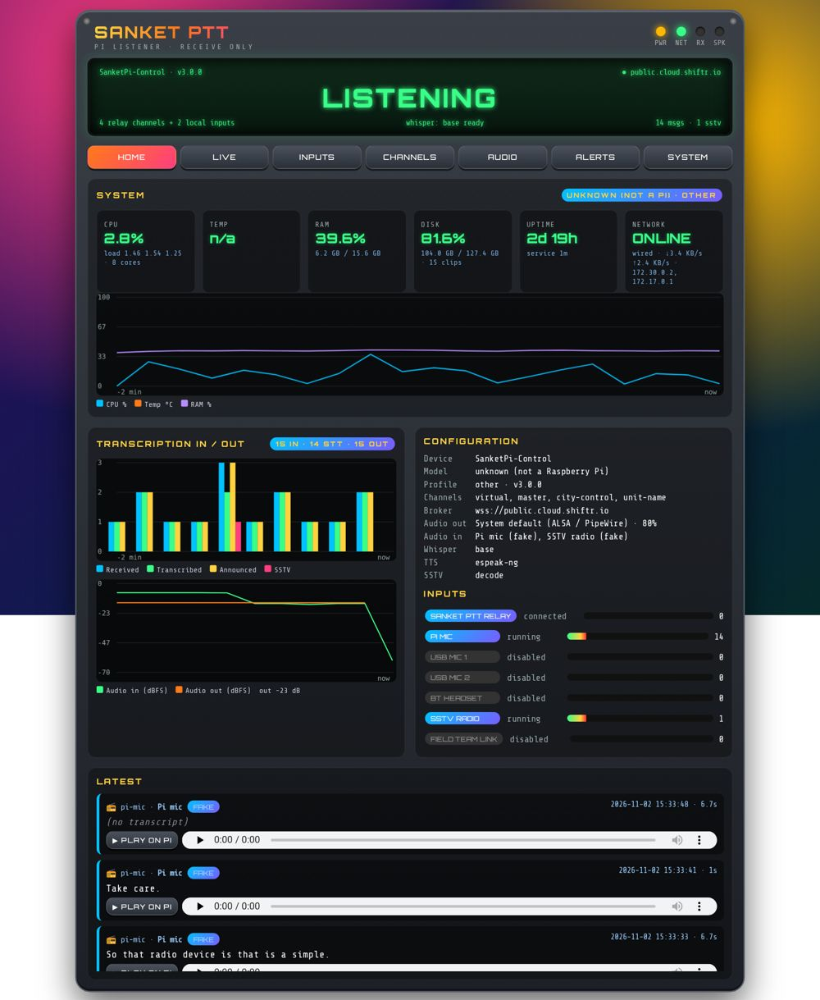
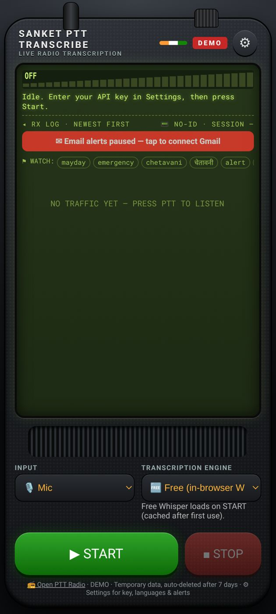
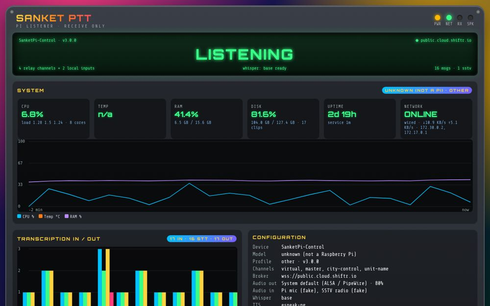

# Sanket PTT

**Push-to-talk web radio for police and emergency departments in India.**

Sanket PTT turns any phone, tablet or PC browser into a talk-group radio. Officers pick a channel, hold the PTT button and talk;
everyone on the channel hears it instantly. Companion tools add live transcription and translation of radio traffic, picture
transmission over voice (SSTV), and a Raspberry Pi listening station (Sanket Edge) for control rooms. No server to run: the
app is a static web page and uses an MQTT relay over secure WebSockets.

## Live links

| App | Link |
|---|---|
| Sanket PTT (radio) | https://vibhvesh.github.io/sanketptt/ |
| Sanket Transcribe | https://vibhvesh.github.io/sanketptt/transcribe/ |
| User guides | https://vibhvesh.github.io/sanketptt/docs/ |

### Android APKs

* [Sanket_PTT.apk](https://github.com/vibhvesh/sanketptt/releases/download/v1.0-android/Sanket_PTT.apk)
* [Sanket_Transcribe.apk](https://github.com/vibhvesh/sanketptt/releases/download/v1.0-android/Sanket_Transcribe.apk)

Allow "install from unknown sources" when prompted. The APKs wrap the web apps and keep audio running in the background.

### Sanket Edge (Raspberry Pi) – one-touch install

```bash
curl -fsSL https://vibhvesh.github.io/sanketptt/pi/install.sh | bash
```

Run the same command again to update. See [pi/README.md](pi/README.md).

## Features

* **PTT** – hold-to-talk voice on named channels (`?ch=name` links), floor control so one person talks at a time, who is online / talking,
  message history with playback, alerts and a settings PIN.
* **SSTV** – send and receive pictures over the voice channel (slow-scan TV), decoded live in the browser.
* **Transcribe** – listens to channels and gives a live transcript with translation to and from Indian languages,
  keyword alerts and optional email of transcripts.
* **Edge Pi device** – receive-only Raspberry Pi 5 / Pi 3 station: plays every transmission, transcribes it offline (Whisper),
  announces it aloud (offline TTS), decodes SSTV, and shows a full-screen dashboard on an attached display. Accepts local mics,
  USB sound cards and Bluetooth audio as extra input channels.
* **Android APKs** – installable apps for Sanket PTT and Sanket Transcribe.

## Screenshots

| Sanket PTT | Sanket Edge dashboard |
|---|---|
|  |  |

| Sanket Transcribe | Edge kiosk |
|---|---|
|  |  |

## User guides

Online: https://vibhvesh.github.io/sanketptt/docs/

* [Sanket PTT User Guide (PDF)](docs/Sanket_PTT_User_Guide.pdf)
* [Sanket Transcribe User Guide (PDF)](docs/Sanket_Transcribe_User_Guide.pdf)
* [Sanket Edge User Guide (PDF)](docs/Sanket_Edge_User_Guide.pdf)

Markdown and HTML versions are in [docs/](docs/README.md).

## Architecture

```
 phones / PCs (browser or APK)          Sanket Transcribe            Sanket Edge (Raspberry Pi)
   Sanket PTT web app                    web app                      Python service + dashboard
          \                                  |                                /
           \------------ MQTT over secure WebSockets (public relay) ---------/
                     topics: <prefix>/<channel>/{presence,floor,audio,sstv}
```

* **MQTT relay** – a public MQTT broker over WSS carries presence, floor control, audio (12 kHz 16-bit PCM chunks) and SSTV
  per channel. Several brokers are configured with automatic fallback; any MQTT-over-WebSocket broker can be used.
* **Web app** – static HTML/JS (`index.html`, `sstv.js`) served by GitHub Pages; no backend. Audio capture and playback use the Web Audio API.
* **Transcribe** – static page (`transcribe/`) subscribing to the same channels and sending audio to a speech-to-text API
  (ElevenLabs) with browser translation.
* **Edge** – `pi/` Python service using the same relay protocol, with offline Whisper, TTS, SSTV decode and a local web dashboard on port 8080.

## Repository structure

```
index.html            Sanket PTT web app
sstv.js               SSTV encoder / decoder
test.js               tests for the web app
transcribe/           Sanket Transcribe web app
pi/                   Sanket Edge (Raspberry Pi) service, installer, dashboard, kiosk
android/              Android wrapper source + build script for the APKs
docs/                 user guides (PDF, Markdown, HTML) and screenshots
.github/workflows/    GitHub Pages deploy
```

## Contact

Akshat Singh – akshatsingh@canberravision.com
