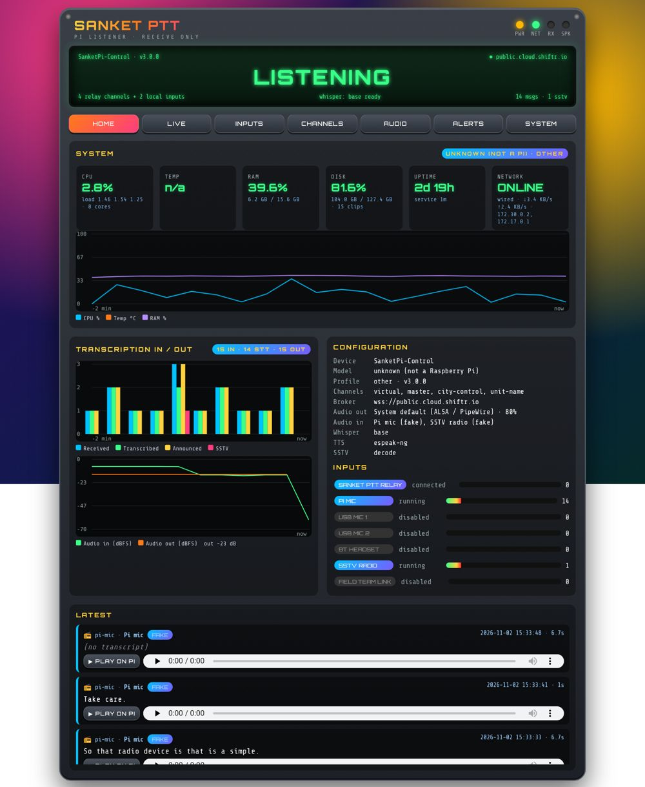
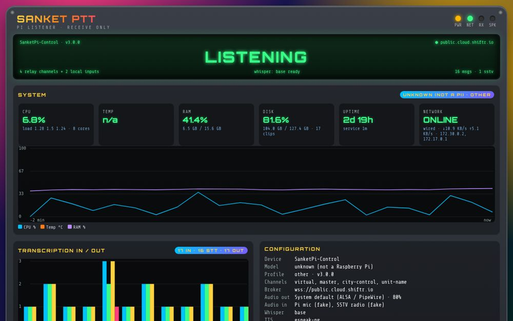
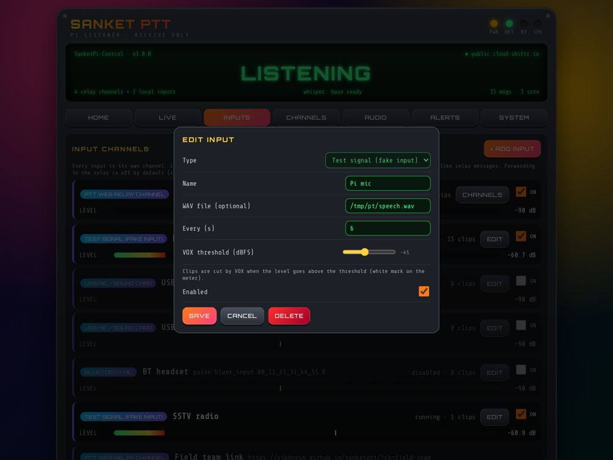
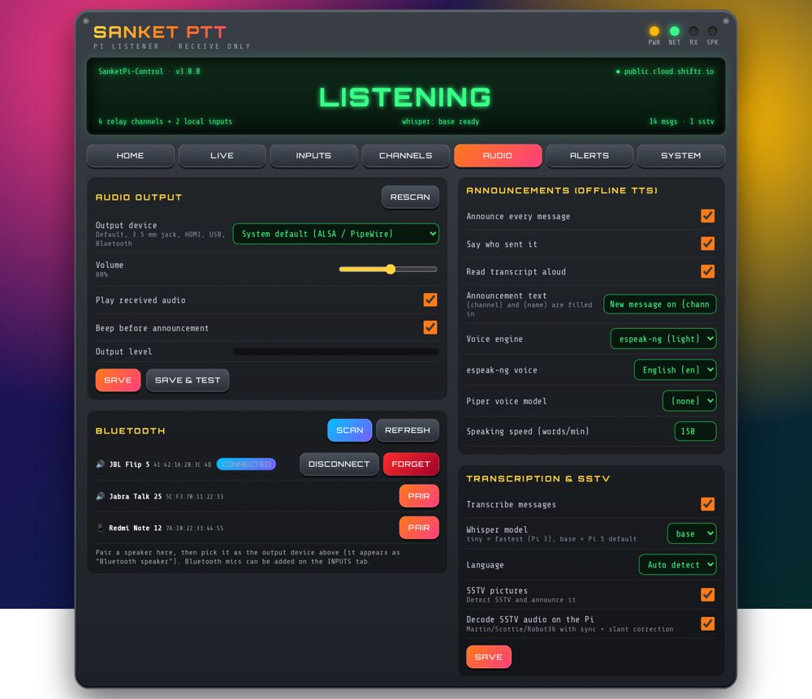
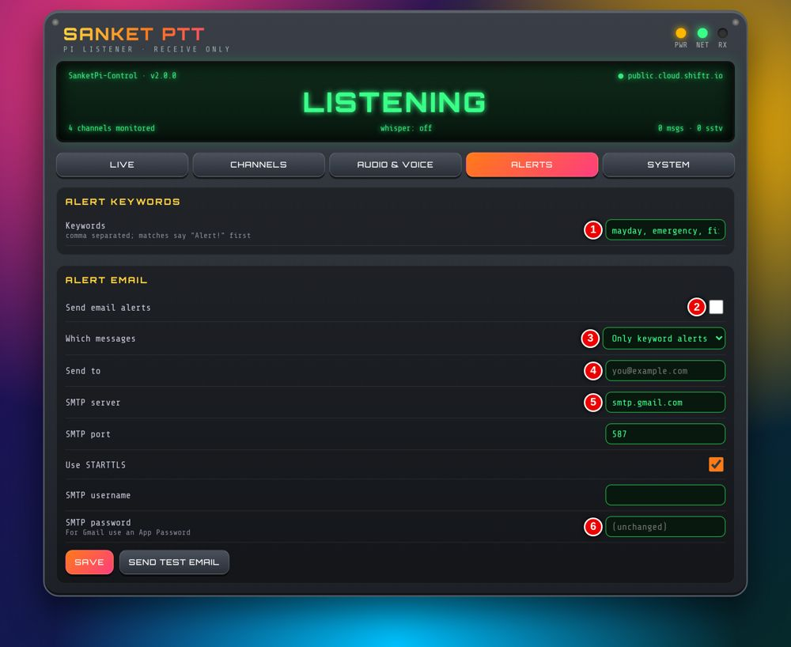
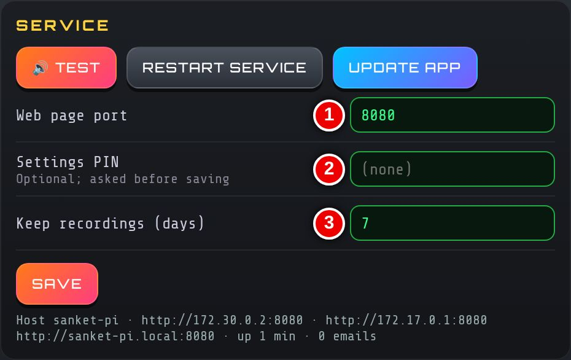

# Sanket Edge — User Guide

*Raspberry Pi listening station for police and emergency control rooms*

Sanket Edge turns a Raspberry Pi and a speaker into an always-on listener. It plays every Sanket PTT transmission, transcribes it on the Pi, reads it aloud, and raises alerts. It is **receive-only** unless you turn on forwarding for a local mic.

## 1. One-touch install

1. Use a Raspberry Pi 5 (recommended) or Pi 3 with Raspberry Pi OS (Desktop or Lite), connected to the internet and a speaker.
2. Open a terminal on the Pi and run:

    ```
    curl -fsSL https://vibhvesh.github.io/sanketptt/pi/install.sh | bash
    ```

3. Wait for it to finish. It prints the web page address.
4. Run the same command any time to **upgrade**. Settings, recordings and voices are kept.

Options: add `SANKET_KIOSK=0` to skip the full-screen display, `SANKET_KIOSK=1` to force it, or `SANKET_HW=pi3|pi5` to choose the board profile, e.g. `curl -fsSL …/install.sh | SANKET_KIOSK=0 bash`.

## 2. Dashboard and kiosk

1. On any phone or PC on the same network, open **http://&lt;pi-name&gt;.local:8080** (or **http://&lt;pi-ip&gt;:8080**).
2. **Home** shows system health (CPU, temperature, RAM, disk, network), message graphs, input levels and the latest messages.
3. **Live** shows the message feed with transcripts, alerts, SSTV pictures and playback.
4. With a display attached, the Pi logs in on boot and opens the dashboard **full screen** (kiosk). If the browser closes, it reopens.





## 3. Inputs

Every input is a channel, listed on the **Inputs** tab.

1. **Relay:** a Sanket PTT channel link (`…/?ch=name`). Add more with **+ Add input**.
2. **Pi mic**, **USB mics / sound cards** (one channel each) and **Bluetooth mics**.
3. Local inputs use **VOX**: set threshold, hang time and gain with **Edit**. Watch the level meter while someone speaks.
4. Forwarding a local input to the relay is **off** by default.




## 4. Audio output and Bluetooth

1. Open **Audio** and choose the output: default, 3.5 mm jack, HDMI, USB or Bluetooth speaker.
2. Set the **volume** and press **Play & test**.
3. For Bluetooth: put the speaker in pairing mode, tap **Scan**, then **Pair** and **Connect**. Use **Disconnect** or **Forget** to remove it.



## 5. Announcements and transcription

1. Each message is played, then announced: *"New message on &lt;channel&gt; from &lt;name&gt;"*, then the transcript is read out.
2. On **Audio**, turn announcements on or off, edit the text and choose the voice (Piper or espeak-ng) and speed.
3. Transcription runs offline (Whisper). Choose the model and language, or **Auto detect**.

## 6. Alerts and PIN

1. On **Alerts**, enter keywords (e.g. mayday, emergency). A match is announced with *"Alert! Alert!"* first.
2. Optionally turn on alert email, fill in the SMTP details and press **Send test email**.
3. On **System**, set a **Settings PIN** right after installing. Anyone can view the dashboard; changes need the PIN.





## 7. Always on

1. Starts on boot and restarts automatically if it stops.
2. A hardware watchdog reboots the Pi if it hangs.
3. Wi-Fi power-save and screen blanking are turned off; the relay reconnects on its own.

## 8. Pi 5 versus Pi 3

| Board | Transcription | Voice | SSTV decode | Kiosk browser |
|---|---|---|---|---|
| Pi 5 / Pi 4 | Whisper base | Piper | On | Chromium |
| Pi 3 / Zero 2 | Whisper tiny | espeak-ng | Off | surf (Desktop) / skipped on Lite |

Defaults are set once at first install; your later changes are kept.

## 9. Troubleshooting

| Problem | Fix |
|---|---|
| Page will not open | Use the IP: run `hostname -I` on the Pi, open `http://<ip>:8080`. |
| No sound | Check speaker power and output device on **Audio**; press **Play & test**. |
| Bluetooth speaker silent | **Scan → Pair → Connect** again, then select it as output. |
| Mic input never triggers | Lower the VOX threshold; check the level meter. |
| Slow transcripts on Pi 3 | Keep the **tiny** model. |
| Check the service | `sudo systemctl status sanket-pi` · logs: `journalctl -u sanket-pi -f` |
| Update | **System → Update app**, or rerun the install command. |

## 10. Support

**Akshat Singh** · <akshatsingh@canberravision.com>
