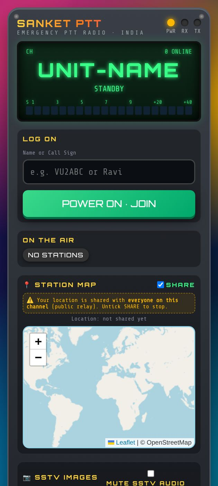
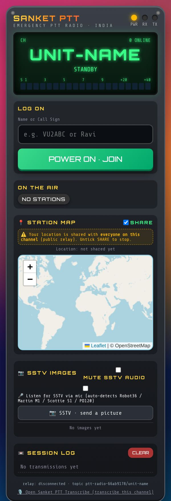

# Sanket PTT — User Guide

*Push-to-talk voice radio for police and emergency departments · Android app and web*

**Web app:** <https://vibhvesh.github.io/sanketptt/>  
**Android app (APK):** <https://github.com/vibhvesh/sanketptt/releases/download/v1.0-android/Sanket_PTT.apk>

> Pilot / demonstration service. Do not send sensitive information.

## 1. What it does

- Hold-to-talk voice on named channels, one speaker at a time.
- See who is on the air, with optional location sharing on a map.
- Replay recent transmissions from the session log.
- Send and receive pictures over SSTV (Robot36, Martin M1, Scottie S1, PD120).

## 2. Install

**Android**

1. Open the APK link above in the phone's browser.
2. When the download finishes, tap the file to open it.
3. If asked, allow **Install unknown apps** for the browser, then tap **Install**.
4. If Play Protect warns, choose **Install anyway**, then tap **Open**.
5. Allow **Microphone**, **Location** and **Notifications** when asked.

**Web:** open the web link in Chrome and add it to the home screen. No installation needed.

## 3. Join a channel

1. Open the channel link from your supervisor, for example `https://vibhvesh.github.io/sanketptt/?ch=unit-name`. The channel is the part after `?ch=`. Do not use the default public channel for official work.
2. Enter your allotted **name or call sign**.
3. Tap **POWER ON · JOIN**. If shown, tap **TAP TO ENABLE AUDIO**.
4. Check that your call sign appears under **ON THE AIR**.

## 4. Talk

1. Listen first and make sure nobody else is speaking.
2. Press and hold the **PTT** button, wait about one second, then speak.
3. Release the button when you finish so others can reply.
4. Missed something? Play it back from the **Session log**.

## 5. Share location

1. Tick **SHARE** in Station map only when instructed.
2. Everyone on the channel can see shared locations.
3. Untick **SHARE** when it is no longer needed.

## 6. Pictures (SSTV)

**Send**

1. Announce on the channel and wait for acknowledgement.
2. Tap **SSTV · send a picture** and choose the picture.
3. Pick a mode: Robot36 (~37 s, fastest), Martin M1, Scottie S1 or PD120.
4. Tap **SEND IMAGE** and wait. The channel is busy while sending (tap ✕ to cancel).

**Receive:** stay joined. Pictures decode automatically and appear under **SSTV images**; download them as PNG. Tick **Listen for SSTV via mic** to decode a nearby handset, or **MUTE SSTV AUDIO** to silence the tones.

## 7. Always on (Android)

1. The screen stays on while the app is open; a "staying on while locked" notification keeps it running when locked.
2. Keep the phone on charge for long shifts.
3. Set the app's battery mode to **Unrestricted** (Settings → Apps → Sanket PTT → Battery).
4. The app loads the live site, so updates arrive automatically. Close and reopen to refresh.

## 8. Troubleshooting

| Problem | Fix |
|---|---|
| No sound | Tap **TAP TO ENABLE AUDIO**; raise phone volume. |
| Cannot talk | Allow the microphone permission; wait until the channel is free. |
| Not in ON THE AIR | Check internet, then tap **POWER ON · JOIN** again. |
| App stops when locked | Set battery to **Unrestricted**; keep the notification on. |
| Wrong channel | Reopen the exact link from your supervisor (`?ch=`). |

## 9. Support

**Akshat Singh** · <akshatsingh@canberravision.com>
