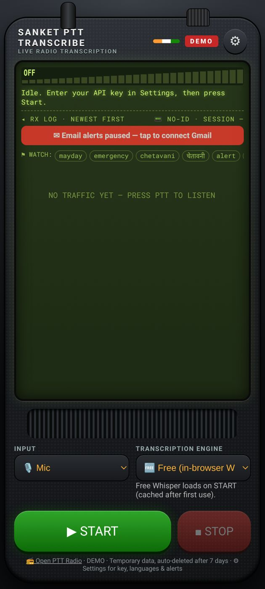
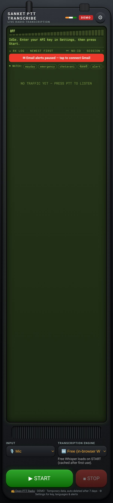

# Sanket Transcribe — User Guide

*Live radio transcription for police and emergency departments · Android app and web*

**Web app:** <https://vibhvesh.github.io/sanketptt/transcribe/>  
**Android app (APK):** <https://github.com/vibhvesh/sanketptt/releases/download/v1.0-android/Sanket_Transcribe.apk>

> Pilot / demonstration service. Do not send sensitive information.

## 1. What it does

Sanket Transcribe listens to a Sanket PTT channel, or the phone's microphone, and turns every transmission into text. It can translate, raise keyword alerts and export clips. It joins as a listener and **never transmits**.

## 2. Install

**Android**

1. Open the APK link above in the phone's browser and tap the downloaded file.
2. If asked, allow **Install unknown apps** for the browser, then tap **Install**.
3. If Play Protect warns, choose **Install anyway**, then tap **Open**.
4. Allow **Microphone** and **Notifications** when asked.

**Web:** open the web link in Chrome and add it to the home screen.

## 3. Start transcribing

1. Under **INPUT** choose **Web page / PTT radio** to monitor a channel, or **Mic** for the local microphone.
2. For a channel, paste the channel link in **PTT LINK**, for example `https://vibhvesh.github.io/sanketptt/?ch=unit-name`.
3. Under **TRANSCRIPTION ENGINE** choose **Free (in-browser Whisper)**. No key is needed. The model (about 79 MB) downloads on first use, so start it once on good Wi-Fi. ElevenLabs is optional and needs an API key.
4. Tap **▶ START**. Tap **■ STOP** to finish.

## 4. Read the log

1. Each transmission becomes a clip in the **RX log**, newest first, with its text and translation.
2. Words in the **WATCH** list are highlighted and raise the alerts you turned on.
3. Download one clip with **⬇ Download**, or everything with **⬇ Download all (.zip)** at the end of the shift.

## 5. Settings (⚙)

1. **Source / Translate:** spoken language and the language to translate into.
2. **Keyword alerts:** words to watch, separated by commas or new lines. Turn on **Beep + vibrate** if needed.
3. **Email alerts:** tap **Connect Gmail for alerts** to email a chosen address, with the audio attached, when a keyword is heard.
4. **Mic squelch:** set **Hang time** and **Threshold margin**; tap **Recalibrate squelch** if background noise changes.
5. **Station / device:** device ID, location (or **Use current location**) and a place label.
6. **ElevenLabs key:** stored only on this device (**Save key / Forget key**).

## 6. Always on (Android)

1. The app keeps running when locked and shows a "staying on" notification.
2. Keep the phone on charge and set battery mode to **Unrestricted**.
3. Updates arrive automatically. Close and reopen the app to refresh.

## 7. Troubleshooting

| Problem | Fix |
|---|---|
| Stuck on "loading model" | Use good Wi-Fi for the first start; it is cached afterwards. |
| No text appears | Check the PTT link and the channel name after `?ch=`; tap START. |
| Mic picks up noise | Tap **Recalibrate squelch** or raise the threshold margin. |
| "Email alerts paused" | Tap the red banner and connect Gmail again. |
| Stops when locked | Set battery to **Unrestricted**. |

## 8. Support

**Akshat Singh** · <akshatsingh@canberravision.com>
