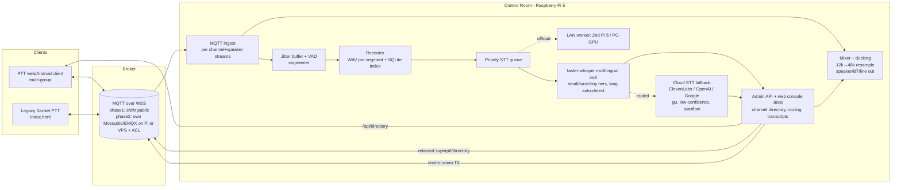

# SuperPTT — Design (v0.1, 2 Nov 2026)

## 1. What exists today (Sanket PTT, repo `vibhvesh/sanketptt`, box checkout `/workspace/sanketptt`)
| Part | Where | Notes |
|---|---|---|
| PTT web radio | `index.html` → https://vibhvesh.github.io/sanketptt/ | One channel per tab, mqtt.js over WSS |
| Transcribe web app | `transcribe/index.html` → …/sanketptt/transcribe/ | Listen-only; in-browser Whisper (`onnx-community/whisper-base`, transformers.js) or ElevenLabs STT; Google/MyMemory translate; Gmail alert mail |
| Android APKs | `android/` (WebView + foreground keep-alive) | Releases `v1.0-android` |
| Pi listener 2.0 | `pi/` (Python, `install.sh` via Pages) | Receive-only, multi-channel/`listen_all`, faster-whisper tiny/base int8, piper/espeak TTS announce, keyword alerts, SSTV decode, web admin :8080 with PIN |
| Original prototype | `/workspace/ptt-static` → vibhvesh.github.io/ptt-radio | |
| Hosting | GitHub Pages (Actions `deploy.yml`) | No server of our own |

**Transport/protocol (kept as-is for compatibility):** public MQTT brokers over WSS (shiftr.io primary; emqx, hivemq, mosquitto fallbacks). Topics `ptt-radio-66ab9178/<channel>/{presence/<id>, floor, audio, sstv}`.
- `presence/<id>`: retained JSON `{id,name,ts,loc?}` heartbeat, empty LWT on leave.
- `floor`: JSON `{t:claim|hb|release,id,name,ts}` — one talker per channel, client-side arbitration.
- `audio`: binary `[len(id)][id bytes][Int16 LE PCM mono 12 kHz]`.
- `sstv`: JSON metadata; image as audio.

**Works:** browser/Android PTT, floor control, presence, SSTV, per-channel transcription on Pi, alerts, Pi web admin.
**Missing / weak:** no admin directory of channels (just ad-hoc names), one channel per client, no multi-group scan/TX, no central recording/archive, no control room mixing, public unauthenticated brokers (anyone with the prefix can listen/inject), floor is advisory only (collisions → interleaved PCM on same topic), Pi transcription is serial (queue grows when many channels talk).

## 2. SuperPTT goals
1. Client connects to an **admin URL** → gets the channel directory it’s allowed to see.
2. **Fast channel switching**; one client **joins many groups** (scan/monitor N, TX on a selected one or "all-call" to several).
3. **Record + transcribe ALL channels simultaneously**.
4. **Control room** (runs on Raspberry Pi 5, local STT) sees all channels, outputs one channel, a selection, or all mixed; can talk into any.
5. **Overlapping speech** handled correctly.

## 3. Architecture

### Components
- **Admin/Directory service** (on the Pi, also mirrored as retained MQTT msg `superptt-<org>/directory`): channels `{id,name,color,priority,members,talk_groups}`, client tokens. Clients open `https://<admin>/join?code=…` → JSON directory + broker URL + credentials.
- **SuperPTT client** (fork of `index.html`): multi-subscription Radio objects sharing one MQTT connection; channel strip with per-channel mute/volume/"scan"; one **TX target** (or group-call list); quick-switch via swipe / number keys / hardware volume buttons in Android wrapper. Pre-emption badge when priority channel talks.
- **Control Room (Pi)**: Python 3, paho-mqtt, numpy, faster-whisper, sounddevice, SQLite, stdlib HTTP server (same style as `pi/sanket`). Reuses Pi 2.0 config/announce/SSTV modules later.
- **Storage**: `data/rec/YYYY-MM-DD/<channel>/<ts>_<speaker>.wav`, `data/superptt.db` (segments, transcripts, events). Daily rotation, retention setting, optional rclone to Drive.

### Data flow (one transmission)
claim on `floor` → ingest opens stream key `(channel, speaker_id)` → audio frames (header tells speaker) appended with arrival time → mixer plays if channel routed → on release/1.5 s silence segment closed → WAV written → job enqueued (priority = channel priority, age) → worker transcribes → transcript row + live feed + keyword alerts.

## 4. Overlapping speech strategy
1. **Separate streams by construction**: each audio frame carries the sender id, so the Pi keys buffers by `(channel, speaker)`; two people talking at once (even on the same channel, despite floor) never get concatenated into one buffer. Physical diarization is mostly unnecessary because every speaker is a separate source. ML diarization (pyannote / resemblyzer) is only for **local inputs** (one mic hearing several people, analog radio via VOX) — phase 4.
2. **Timestamps**: each segment has `t_start` (first frame arrival, Pi monotonic clock mapped to UTC) and `t_end`; Whisper word/segment timestamps offset by `t_start`. Merged transcript = all segments ordered by `t_start`, with **overlap markers** when intervals intersect (UI shows them side by side, "⟂ overlapped with …"). Phase 2 adds sender `ts` in frame header for accurate ordering over jitter.
3. **Floor control hardened**: server-side arbiter on the Pi (optional) — first claim wins, priority users (control room, supervisor) can pre-empt; clients receive `deny`/`preempt` on `floor`. Legacy clients keep advisory behaviour.
4. **Cross-channel overlap in the mix**: per-channel gain, **priority ducking** (higher-priority/"focused" channel active → others −12 dB with 50 ms attack/400 ms release), soft limiter on sum, optional stereo panning per channel so operators can separate voices spatially. Output modes: *single*, *selected set*, *all*.
5. **Transcription under overlap/load**: queue is per-segment, so simultaneous talkers become independent jobs. Short segments < 0.4 s dropped; queue length > threshold → switch to `tiny`, then to Vosk, then mark "pending" and backfill when idle (recordings are always kept, so nothing is lost).

## 5. Capacity for 50 users on one Pi 5 (honest sizing)
**Traffic model.** With floor control there is at most one talker per channel (collisions are rare and short). For 50 users on ~8–15 channels, a busy shift is about 20 transmissions/user/hour × ~4 s ≈ **4,000 s of speech/hour ≈ 1.1 talkers on average**. Peaks (an incident) might hit **5–8 channels at once for 10–60 s**, and the sustained busy-hour average stays ≈ 2–3× the normal level.

**Measured on the box** (x86, 8 cores, 2 threads/model, faster-whisper int8, 4–5 s clips, 2 Nov 2026): base RTF ≈ 0.22–0.6; small RTF ≈ 0.57–0.68 (en/hi), with Gujarati slow (up to 5× RTF when it hallucinates, now capped). **A Pi 5 (Cortex-A76) is typically ~2–3× slower** than that box, so these are estimates, not measured on a Pi.

| Pi 5 setup | Est. RTF/worker | Throughput (2 workers ×2 threads) | Verdict |
|---|---|---|---|
| tiny (multilingual) | ~0.3 | ~6 speech-sec/sec | fine for load spikes; poor Hindi/Gujarati |
| **base** | ~0.5–0.8 | **~2.5–4 speech-sec/sec** | **handles 50 users' average (1.1) with headroom; peaks of 5–8 talkers queue for a minute or two, then catch up** |
| small | ~1.5–2 | ~1–1.3 speech-sec/sec | OK only when idle; cannot keep up with peaks alone |

Policy implemented: **small when the queue is empty → base normally → tiny when queue > 6 → optional LAN worker / cloud.** Recording, mixing and the live console never wait on STT, and nothing is lost: segments stay `pending` and are backfilled. Worst case on a busy incident, transcripts lag by a few minutes, not seconds. For "always under 10 s" at peak, add one LAN worker (second Pi 5 ≈ doubles throughput; any recent PC with an NVIDIA GPU running `small`/`large-v3` clears the whole backlog in real time).

## 5a. Multilingual (English, Hindi, Gujarati, any language)
- Only multilingual Whisper models (`tiny/base/small/medium/large-v3`, never `*.en`). Language is **detected per utterance**; config `language_hints` per channel (e.g. `{"gujarat-ops":["gu","hi","en"]}`) overrides an out-of-set guess.
- **Script guard**: Whisper often writes Hindi in Urdu script and Gujarati in Devanagari; if the output isn't in the detected language's script, it re-runs with a script-priming prompt and keeps the better result.
- **Honest quality, tested with synthetic TTS speech on the box:** English fine on base/small. Hindi: base is rough (sometimes Urdu script, words garbled); small is good. **Gujarati: tiny/base/small are not usable.** base misdetected it as Romanian/Hindi; small detected `gu` but wrote Devanagari or nearly nothing. Gujarati needs **medium/large-v3** (only on a PC/GPU LAN worker, too slow on a Pi) or a cloud STT. Real radio audio (12 kHz, noisy) will be worse than TTS.
- Translation (to English/Hindi) stays a later phase (reuse the Sanket Transcribe translate code).

## 5b. Offload and fallback (same queue)
- **LAN workers** (`worker.py`): a second Pi 5 or a PC/GPU pulls jobs from `POST /api/jobs/claim` and posts results back (shared `worker_token` shown once on first-run setup). Jobs are leased for 120 s and re-queued if a worker dies. Run the Pi record-only with `local_stt:false` if a strong worker exists.
- **Cloud fallback (user decision 2 Nov 2026: local by default, cloud as fallback)**. See 5c.

## 5c. Local → cloud routing (implemented in `stt.py` + `cloud.py`)
Every utterance is transcribed **locally first** (Whisper on the Pi or a LAN worker). It is then sent to the cloud only when one of these applies; the reason is stored per message:
| Reason | Rule (configurable in `cloud`) |
|---|---|
| `lang:<xx>` | detected language is in `cloud.langs` (default gu, pa, or, as, kn, ml, te, ta, mr, bn, ne, si) |
| `expected:<xx>` | the channel's first `language_hints` entry is in `cloud.langs` (e.g. a Gujarati ops channel) |
| `script` | output is still in the wrong alphabet after the re-try |
| `lowconf` | worst segment avg_logprob < `min_avg_logprob` (-0.8) |
| `lowlang` | language-detect probability < `min_lang_prob` (0.5) |
| `empty` | no text but no_speech prob < `max_no_speech` (speech probably missed) |
| `queue` | STT queue > `when_queue_over` (12): cloud **first**, local only if cloud fails |
Providers: **ElevenLabs Scribe** (`scribe_v1`, default, same vendor as the old Transcribe app), **OpenAI-compatible** (`whisper-1`, `gpt-4o-transcribe`, `gpt-4o-mini-transcribe`, or any compatible URL such as Groq), **Google Speech-to-Text** (v1p1beta1 REST with API key, `gu-IN`/`hi-IN`/`en-IN` + alternative languages).
Language sent to the cloud: only a trusted language (from a `lang:`/`expected:` rule or a fixed `language`); otherwise auto-detect. A wrong local guess forced Devanagari output for Gujarati in testing. Key: `cloud.api_key` or env `ELEVENLABS_API_KEY`/`OPENAI_API_KEY`/`GOOGLE_API_KEY` (systemd `EnvironmentFile=/etc/superptt.env`).
**Real ElevenLabs test (2 Nov 2026, synthetic TTS samples):** Gujarati → `ઉત્તર દરવાજા પાસે આગ લાગી છે. તરત મદદ મોકલો.` (gu, exact), Hindi → `उत्तर gate के पास आग लगी है। तुरंत मदद भेजो।` (hi), English stayed local; cloud latency 1.6–3.7 s per 4–5 s clip.
Failure handling: no key → local result kept, marked `nokey`; cloud error → local kept, marked `retry`, and a background loop re-sends every `retry_s` (300 s) for 3 days. Both the local and cloud text are stored, and the console shows **⌂ LOCAL / ☁ CLOUD**, the reason, and the local text under a cloud result. The key is set in the console (or `config.json`) and never returned by the API.
Tested on the box with a mock cloud server (all three providers): English stayed local; Gujarati and weak Hindi (base) went to cloud for `lowconf`; an expected-Gujarati channel went to cloud; cloud down → local kept → re-sent after recovery; no key → kept local, then sent once a key was set; queue overflow went to cloud first.
Cost/privacy: only flagged utterances leave the Pi. Expect roughly 10–40% of traffic on mixed Hindi/Gujarati channels, ~100% on Gujarati-only channels.

## 6. Security, outside access, retention (decided 2 Nov 2026)
- **Broker: keep the public shiftr broker** (user decision). Risk accepted: anyone with the topic prefix can listen/inject. Mitigation later: per-org random prefix (P2).
- **Outside access: Cloudflare Tunnel** from the Pi (no open ports). Quick tunnel (trycloudflare, URL changes on restart) by default; named tunnel on the user's domain for production. See README.
- **Hardening:** only login/session/LAN-only setup are unauthenticated; PBKDF2 PIN; per-IP + global lockout; HttpOnly/SameSite=Strict/Secure cookie; CSRF header; HTTPS redirect + HSTS via tunnel; CSP; worker API LAN-only; `/api/directory` needs session or read-only directory token.
- **Retention:** 30 days audio + 30 days transcripts by default (console-editable); daily cleanup; disk guard at <10% free deletes oldest audio first, keeps transcripts.
- Tested on the box: auth/lockout/cookie/redirect/CSRF/worker/directory/traversal with simulated tunnel headers; retention + guard. **A real quick tunnel could not be tested from the box**: its network blocks Cloudflare's tunnel port 7844 (QUIC and HTTP/2 both failed). It must be verified on the Pi.

## 6b. Built: SuperPTT app + control-room talk-back (2 Nov 2026)
- `app/`: static PWA, wire-compatible with Sanket PTT. Multi-channel listen, per-sender mixer with ducking, one-tap TX switch, ALL-CALL, adaptive floor grace (own-claim echo), cut-in honoring (`prio` ≥ 9).
- Control-room talk-back: console HOLD-TO-TALK to checked or all channels, optional **cut-in** (`prio 9`, `ts 1`, which also wins on legacy clients); browser mic sends 12 kHz PCM to `/api/tx/audio`; floor hb every 1 s; auto-stop after 3 s without audio; own audio recorded but never played back to the Pi speaker.
- Live-broker E2E on an isolated prefix: **12/12 passed** (multi-listen, legacy interop, switch, all-call, cross-channel overlap without garbling, ducking, same-channel race, cut-in preempts SuperPTT + takes legacy floor, all-channel talk-back). The control room recorded every segment with overlaps flagged.

## 7. Phased build plan
- **P0 (now, scaffold)**: `control-room/` Pi app — multi-channel ingest (all/listed), per-speaker segmentation, recording, SQLite, local faster-whisper queue with fallback, mixer with routing + ducking, web console, install script. Compatible with current Sanket clients.
- **P1**: SuperPTT client (multi-group scan, quick switch, TX target, admin-URL join), directory API, control-room TX from console mic.
- **P2**: own broker + ACL, server floor arbiter with priority/pre-emption, sender timestamps in frames, Opus option.
- **P3**: search/export of transcripts, daily reports, alerts (reuse Pi 2.0 email/TTS), Drive backup.
- **P4**: diarization for local/analog inputs, multi-Pi federation, translation.

## 8. Decided (2 Nov 2026)
Pi 5 control room · up to 50 users · English, Hindi, Gujarati + any language (auto-detect).

## 9. Open questions
1. ~~Broker~~ decided: public. 2. ~~Remote access~~ decided: Cloudflare Tunnel. Open: named-tunnel domain?
3. ~~Retention~~ default 30/30 days. Was: how many days of WAV + transcripts to keep (12 kHz WAV ≈ 86 MB per hour of speech; a busy 10-hour day for 50 users ≈ 1 GB/day, ~0.15 GB/day if Opus-compressed)? Backup to Drive?
4. ~~Cloud?~~ Decided: cloud fallback, local default. Still open: which provider/key (ElevenLabs default).
5. Who can pre-empt the floor, and should the control room transmit?
